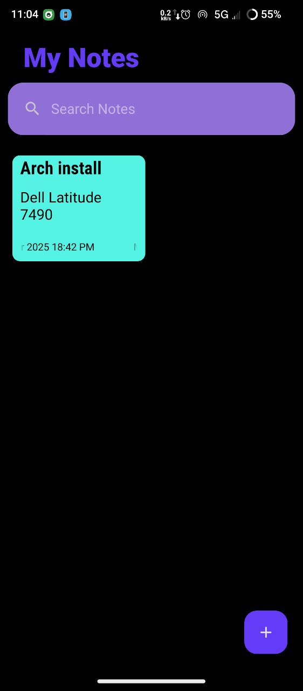
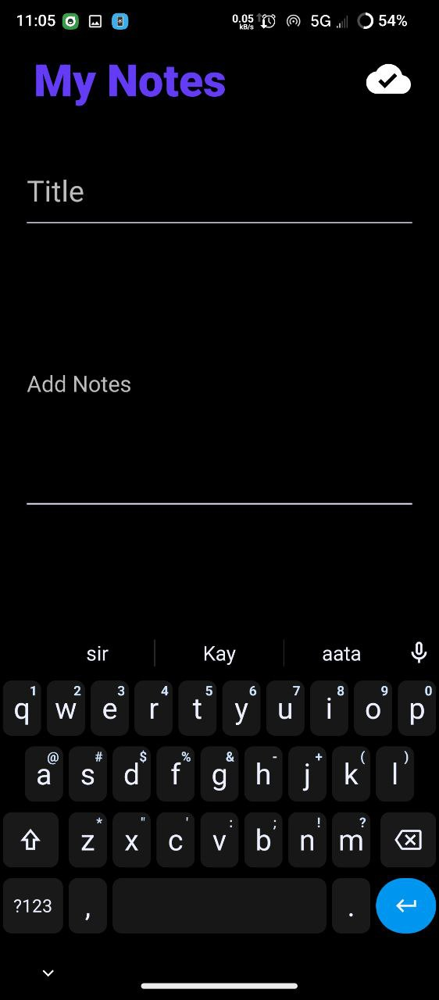
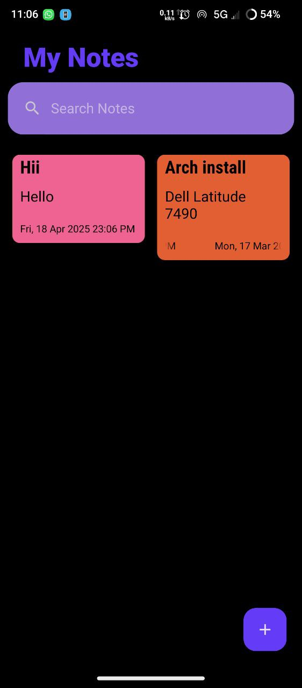
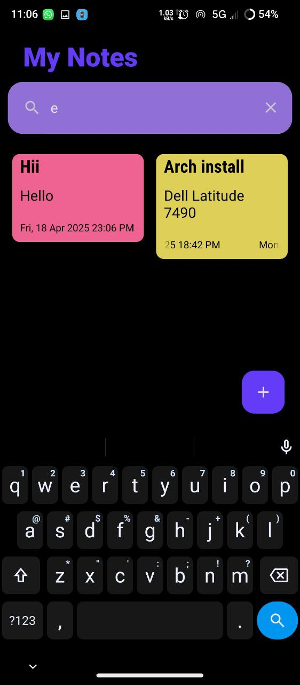

# My Notes

**My Notes** is a lightweight, offline-first Android app for notes and tasks, written in Java with the native Android SDK. Notes, tasks, due dates, and reminders are stored locally with Room, so the app works without an account, a network connection, or a cloud service.

The project is intentionally small: it is a practical reference for Android fundamentals (activities, fragments, XML layouts, RecyclerView, Room, Material components, and AlarmManager) and a usable personal productivity app.

---

## Features

### Notes

- **Create notes** with an optional title and a body; blank bodies are blocked and titles fall back to “Untitled”.
- **Edit existing notes** by tapping a card. Auto-save is **on by default**: edits persist half a second after typing, a transient “Saving…/Saved” status confirms the write, and an interrupted editor restores its unsaved draft. Turn auto-save off in Settings to use the explicit Save action and dirty-state confirmation instead.
- **Search** titles and bodies with a short debounce, a clear affordance, result counts, and a dedicated no-results state.
- **Pin, unpin, and delete** from each card’s overflow menu or long press. Pinned notes sort first with a short pin confirmation, deletes can be undone from the Snackbar, and pin changes are announced.
- **Explicit states** for loading, empty, search-empty, error, and content, with a scrollable empty state that survives large font scales and skeleton cards while the first load resolves.

### Tasks

- **Create and edit tasks** with a title, optional details, a due date/time, and an optional reminder.
- **Reminder offsets** include none, at due time, 5/15/30 minutes, 1 hour, and 1 day before. A configurable default reminder is applied when a new task first gets a due date.
- **Filter by All, Today, Upcoming, or Done.** Today includes overdue tasks; Upcoming starts tomorrow. The subtitle shows the count for the active filter.
- **Complete tasks** with the round check button. Completed tasks get a strikethrough and move to the Done filter. Deleting from the list offers Snackbar Undo; deleting from the editor asks for confirmation.
- **Reminder delivery** uses exact alarms when the user grants the special alarm permission, with an inexact fallback otherwise. Reminders survive a reboot/package update, are canceled when a task is completed or deleted, and open the task editor when tapped.

### App

- **Local persistence** with Room — no account and no network required.
- **Material 3 light/dark theme** built from semantic colour, type, spacing, and component tokens. Choose System, Light, or Dark in Settings, or use the app-bar theme action to pin light/dark.
- **Fluid, accessible motion**: shared-element note editor transitions, a tab fade, skeleton loading cards, and a short pin confirmation. Motion respects the system animation scale, so animated skeletons and transitions are skipped when animations are disabled.
- **Settings** for note auto-save, appearance, notification permission, exact-alarm access, default reminder, and backup/restore. About shows the app version and local note/task counts.
- **Backup and restore** through the system file picker. Backups are human-readable `notes-backup.json` files containing both notes and tasks; restore supports Merge or Replace.
- **Responsive layout**: a bottom navigation bar on phones and a navigation rail on tablets/foldables, a 2/3/4-column note grid, a 720dp content cap for Tasks/Settings and the note editor, and tablet-aware editor margins. System bars and the IME are handled edge-to-edge on API 30+.

> The interface has been validated on an Android 14 emulator at phone and tablet widths, in light and dark themes, and at 200% font scale. Interactive controls include content descriptions and 48dp touch targets. See [`docs/UI_UX_PLAN.md`](docs/UI_UX_PLAN.md) for the design rationale and validation protocol.

---

## Screenshots

<p>
  
  
  
  
</p>

> These are **archived pre-refactor screenshots**. The current build adds the tabbed Notes/Tasks shell, navigation rail, task editor, reminders, Settings, and the backup/restore flow described below.

---

## Project structure

```plaintext
My-Notes/
├── app/
│   ├── build.gradle.kts
│   ├── schemas/                               ← Exported Room schemas (versions 2 and 3)
│   ├── src/main/
│   │   ├── AndroidManifest.xml
│   │   ├── java/com/shivjeet1/mynotes/
│   │   │   ├── MainActivity.java              ← Thin shell: tab host, bottom bar/rail
│   │   │   ├── NotesFragment.java             ← Notes list, search, states, pin/delete/undo
│   │   │   ├── TasksFragment.java             ← Task filters, complete/delete/undo
│   │   │   ├── NotesTakeActivity.java         ← Note editor, autosave/draft recovery, transitions
│   │   │   ├── TaskEditorActivity.java        ← Due date/time, reminders, done, delete
│   │   │   ├── SettingsActivity.java          ← Auto-save, theme, reminders, counts, backup/restore
│   │   │   ├── NotesApplication.java          ← Theme bootstrap and notification channel
│   │   │   ├── Adapter/
│   │   │   │   ├── NoteListAdapter.java
│   │   │   │   └── TaskListAdapter.java
│   │   │   ├── Database/
│   │   │   │   ├── MainDAO.java
│   │   │   │   ├── TaskDao.java
│   │   │   │   └── RoomDb.java                ← Room v3 + MIGRATION_2_3
│   │   │   ├── Model/
│   │   │   │   ├── Notes.java
│   │   │   │   └── Task.java
│   │   │   ├── receiver/
│   │   │   │   ├── ReminderReceiver.java      ← Notification posting, fired state
│   │   │   │   └── BootReceiver.java          ← Reschedule after boot/update
│   │   │   └── util/
│   │   │       ├── AppBarActions.java
│   │   │       ├── AppExecutors.java
│   │   │       ├── AppPreferences.java
│   │   │       ├── BackupManager.java         ← notes-backup.json reader/writer
│   │   │       ├── DirtyStateController.java
│   │   │       ├── MaxWidthLinearLayout.java
│   │   │       ├── Motion.java                ← Reduced-motion-aware durations
│   │   │       ├── NoteDraftStore.java        ← Unsaved editor draft journal
│   │   │       ├── ReminderScheduler.java
│   │   │       ├── TaskDates.java
│   │   │       └── WindowInsetsHelper.java
│   │   └── res/
│   │       ├── anim/                          ← Editor enter/exit animations
│   │       ├── color/                         ← Stateful stroke, nav, and disabled-text selectors
│   │       ├── drawable/                      ← Theme, task, reminder, and navigation icons
│   │       ├── layout/                        ← Shell, notes, tasks, settings, editors, cards
│   │       ├── layout-sw600dp/                ← Tablet rail shell and capped note editor
│   │       ├── menu/                          ← Navigation, overflow, editor actions
│   │       ├── transition/                    ← Shared-element enter/return transition sets
│   │       ├── values/                        ← Tokens, themes, dimensions, strings
│   │       ├── values-night/                  ← Dark semantic colours and system bar theme
│   │       ├── values-sw600dp/                ← Tablet spacing and 3-column grid
│   │       ├── values-sw840dp/                ← Wide-tablet spacing and 4-column grid
│   │       └── values-land/                   ← Landscape grid
│   └── src/androidTest/                       ← Room migration, DAO, and backup tests
├── docs/UI_UX_PLAN.md                         ← Design plan, decisions, validation protocol
├── static/mynotes/                            ← Archived pre-refactor screenshots
├── gradle/libs.versions.toml                  ← Dependency versions
├── Makefile                                   ← Command-line build helpers
├── build.gradle.kts
├── settings.gradle.kts
├── gradlew
└── README.md
```

---

## Requirements

- Android 7.0 (API 24) or newer on the device.
- **JDK 17** (AGP 8.7.2 and Gradle 8.9 do not support newer JDKs such as JDK 27).
- Android SDK Platform **34** and Build-Tools **34.0.0**.
- `adb` for installing on a physical device.

The Gradle wrapper downloads Gradle 8.9 automatically; you do not need to install Gradle separately.

---

## Build on Arch Linux without Android Studio

The entire app can be built and installed from a terminal. The commands below use the upstream Android command-line tools; no IDE is required.

### 1. Install the system packages

```bash
sudo pacman -S --needed base-devel curl unzip jdk17-openjdk android-tools android-udev
sudo archlinux-java set java-17-openjdk
java -version
```

`java -version` should report **17.x**. The `android-tools` package provides `adb`; `android-udev` provides device permissions. If you prefer a different JDK path, pass it explicitly to Make: `make debug JAVA_HOME=/path/to/jdk17`.

### 2. Set up the Android SDK

The Makefile can bootstrap the SDK in one step:

```bash
make setup
```

This downloads the Android command-line tools into `~/Android/Sdk`, accepts the SDK licences, installs `platform-tools`, `platforms;android-34`, and `build-tools;34.0.0`, and writes `local.properties`.

Use a different SDK location if you prefer:

```bash
make setup ANDROID_HOME="$HOME/.local/share/android-sdk"
```

Or point the build at an SDK that is already installed:

```bash
make local-properties ANDROID_HOME=/opt/android-sdk FORCE=1
```

#### Manual SDK setup (without Make)

If you want to see or control every step:

```bash
export ANDROID_HOME="$HOME/Android/Sdk"
export ANDROID_SDK_ROOT="$ANDROID_HOME"
mkdir -p "$ANDROID_HOME/cmdline-tools"

# Check https://developer.android.com/studio#command-line-tools-only for the
# current commandlinetools-linux-*_latest.zip URL if this one has moved.
curl -fL -o /tmp/cmdline-tools.zip \
  "https://dl.google.com/android/repository/commandlinetools-linux-15859902_latest.zip"

unzip -q /tmp/cmdline-tools.zip -d "$ANDROID_HOME/cmdline-tools"
mv "$ANDROID_HOME/cmdline-tools/cmdline-tools" \
   "$ANDROID_HOME/cmdline-tools/latest"

export PATH="$ANDROID_HOME/cmdline-tools/latest/bin:$ANDROID_HOME/platform-tools:$PATH"

sdkmanager --licenses
sdkmanager --install "platform-tools" "platforms;android-34" "build-tools;34.0.0"

printf 'sdk.dir=%s\n' "$ANDROID_HOME" > local.properties
```

Add the environment variables to your shell startup file so later terminals can find the SDK:

```bash
# ~/.zshrc or ~/.bashrc
export ANDROID_HOME="$HOME/Android/Sdk"
export ANDROID_SDK_ROOT="$ANDROID_HOME"
export PATH="$ANDROID_HOME/cmdline-tools/latest/bin:$ANDROID_HOME/platform-tools:$PATH"
```

> If the command-line tools URL returns 404, copy the current link from the Android Studio download page and pass it to Make: `make sdk-bootstrap CMDLINE_TOOLS_URL="https://..."`.

### 3. Verify the toolchain

```bash
make doctor
```

This checks the JDK version, `sdkmanager`, Platform 34, Build-Tools 34.0.0, `adb`, and `local.properties`. Fix anything marked `[fail]` before continuing.

### 4. Build

```bash
make debug
```

Equivalent Gradle command:

```bash
./gradlew assembleDebug
```

The APK is written to:

```text
app/build/outputs/apk/debug/app-debug.apk
```

### 5. Install and run on a device

Enable **Developer options → USB debugging** on the phone, connect it, and authorise the computer when prompted.

```bash
make devices     # confirm the device is visible
make install     # build if needed and install the debug APK
make run         # install and launch the app
```

Or manually:

```bash
adb install -r app/build/outputs/apk/debug/app-debug.apk
adb shell am start -n com.shivjeet1.mynotes/.MainActivity
```

If `adb devices` shows `no permissions`, reinstall/refresh `android-udev`, reconnect the cable, and make sure your user is in the `adbusers` group:

```bash
sudo usermod -aG adbusers "$USER"
# log out and back in, then reconnect the device
```

### Make targets

Run `make help` for the full list.

| Command | What it does |
| :--- | :--- |
| `make setup` | One-time SDK bootstrap, licence acceptance, and `local.properties` |
| `make doctor` | Check JDK, SDK packages, `adb`, and project configuration |
| `make debug` | Build the debug APK |
| `make install` | Install the debug APK on the connected device |
| `make run` | Install and launch the app |
| `make test` | Run JVM unit tests |
| `make connected-test` | Run instrumented Room/backup tests on a device or emulator |
| `make lint` | Run Android lint |
| `make release` | Build the release APK (signed when the `MYNOTES_*` variables are set) |
| `make bundle` | Build the release App Bundle (same signing rules) |
| `make uninstall` | Uninstall the app from the connected device |
| `make logcat` | Stream device logcat |
| `make clean` | Delete Gradle build outputs |

Override toolchain paths on the command line:

```bash
make debug JAVA_HOME=/usr/lib/jvm/java-17-openjdk
make install ANDROID_HOME=/path/to/android-sdk
make local-properties FORCE=1
```

### CI and signed releases

GitHub Actions runs [`.github/workflows/android-build-release.yml`](.github/workflows/android-build-release.yml) on every push to `master`, every pull request, and every `v*` tag. The build job installs Platform 34 and Build-Tools 34.0.0 explicitly, then runs `assembleDebug testDebugUnitTest lintDebug` and uploads `app-debug.apk` as an artifact.

A tag push also runs the release job, which refuses to publish rather than silently uploading an unsigned APK. Configure these repository secrets first:

| Secret | Purpose |
| :--- | :--- |
| `KEYSTORE_BASE64` | Base64-encoded release keystore (`.jks`) |
| `KEYSTORE_PASSWORD` | Keystore password |
| `KEY_ALIAS` | Release key alias |
| `KEY_PASSWORD` | Release key password |

The job decodes the keystore to a temporary file, exports the `MYNOTES_*` variables consumed by `app/build.gradle.kts`, builds a signed APK, and creates a GitHub Release for the tag with the APK attached.

To sign locally, export the same variables and run Gradle:

```bash
export MYNOTES_KEYSTORE_FILE="$HOME/keys/mynotes.jks"
export MYNOTES_KEYSTORE_PASSWORD="…"
export MYNOTES_KEY_ALIAS="mynotes"
export MYNOTES_KEY_PASSWORD="…"
make release
```

Without those variables the release build still succeeds but produces an unsigned APK, which is useful for smoke tests but should not be distributed.

---

## Tasks, reminders, and backup

### Reminder behaviour

- A reminder is optional. Without a due date, reminder chips are disabled; clearing the due date also clears the reminder.
- On Android 13+, choosing a reminder asks for notification permission at that moment. If permission is denied, the editor shows a warning with a shortcut to system notification settings.
- On Android 12+, exact alarms require the **Alarms & reminders** special access. Settings → Reminders → **Precise timing** opens the grant screen. Without it, the app falls back to an inexact alarm automatically.
- Reminders are rescheduled after a reboot and after an app update. Completing or deleting a task cancels its pending alarm; undo restores a future reminder.
- The notification opens the task editor. The notification channel is created by `NotesApplication`, and the receiver records that the reminder fired so it is not posted twice.
- Settings → **Default reminder** can be **No reminder** or one of the supported offsets. It applies only when a new task first receives a due date; editing an existing task keeps its reminder unless you change it.

### Backup format

Settings → Data → **Back up data** writes `notes-backup.json` through the system file picker. **Restore data** validates the file, shows the note/task counts, and offers:

- **Merge** — adds the backup's notes and tasks, assigning new local IDs.
- **Replace** — deletes local notes/tasks first and then restores the backup.

Both paths preserve task due dates, reminder times, completed state, and reminder-fired state. Restore cancels stale alarms, reschedules reminders for the restored tasks, and tells the tab screens to reload. The format is UTF-8 JSON with a version header:

```json
{
  "format": "mynotes-backup",
  "version": 1,
  "exportedAt": "2026-10-22T06:30:00Z",
  "counts": { "notes": 3, "tasks": 1 },
  "notes": [
    { "id": 1, "title": "Groceries", "note": "Milk and coffee", "date": "22 Oct 2026", "pinned": true }
  ],
  "tasks": [
    { "id": 1, "title": "Call the dentist", "notes": "", "dueAt": 1792639800000,
      "remindAt": 1792638900000, "reminderFired": false, "done": false,
      "createdAt": 1792546000000, "completedAt": 0 }
  ]
}
```

Unknown formats and versions newer than the app supports are rejected with a readable error. Backups are manual; uninstalling the app clears its Room database, so export first if you need a portable copy.

### Tablet and large-screen layout

At `sw600dp` and above, `MainActivity` uses a `NavigationRailView` instead of the bottom bar, leaving the two destinations visible while the content pane keeps its own app bar and FAB. The Tasks and Settings content is capped at 720dp and centered; the task editor uses its existing responsive horizontal margins. The notes grid switches from two columns on phones to three at `sw600dp` and four at `sw840dp`.

---

## Troubleshooting

### `Unsupported class file major version` or “Android Gradle plugin requires Java 17”

The default JDK on Arch may be newer than the one AGP 8.7 supports. Install and select JDK 17:

```bash
sudo pacman -S jdk17-openjdk
sudo archlinux-java set java-17-openjdk
java -version
```

Alternatively, keep your default JDK and select 17 only for the build:

```bash
make debug JAVA_HOME=/usr/lib/jvm/java-17-openjdk
```

### `SDK location not found`

Set `ANDROID_HOME`, or write `local.properties` at the repository root:

```bash
printf 'sdk.dir=%s\n' "$HOME/Android/Sdk" > local.properties
```

`local.properties` is machine-specific and is already ignored by Git.

### `Failed to install the following Android SDK packages ... licenses`

Accept the licences explicitly:

```bash
"$ANDROID_HOME/cmdline-tools/latest/bin/sdkmanager" --licenses
```

### `sdkmanager: command not found`

Check the path and add it to your shell:

```bash
ls "$ANDROID_HOME/cmdline-tools/latest/bin/sdkmanager"
export PATH="$ANDROID_HOME/cmdline-tools/latest/bin:$PATH"
```

### `Warning: SDK processing. This version only understands SDK XML versions up to 3`

This is a version-skew warning between a very new command-line-tools release and AGP 8.7.2. It is non-fatal in the tested build. If it becomes an error, either update `agp`/Gradle together in [`gradle/libs.versions.toml`](gradle/libs.versions.toml), or install a command-line-tools version contemporaneous with AGP 8.7.

### `adb: no permissions` / device not listed

```bash
sudo pacman -S android-udev
sudo usermod -aG adbusers "$USER"
adb kill-server
adb devices
```

Log out and back in after changing groups, then reconnect the USB cable. On some devices you also need to accept the “Allow USB debugging?” prompt again.

### First launch shows an empty screen

The empty state is intentional when Room has no data. Tap **Create first note** on the Notes tab, or open the Tasks tab and tap **Create your first task**, to open the relevant editor. If the loading skeleton never resolves, check for a Room/database error:

```bash
adb logcat -s NotesFragment TasksFragment SettingsActivity TaskEditorActivity
```

The debug build logs database failures under the fragment/activity tags.

### Release APK is unsigned

This is expected when the `MYNOTES_KEYSTORE_FILE`, `MYNOTES_KEYSTORE_PASSWORD`, `MYNOTES_KEY_ALIAS`, and `MYNOTES_KEY_PASSWORD` variables are not set. Export all four (see [CI and signed releases](#ci-and-signed-releases)) before running `make release` if you need an installable, signed build.

### Reminders do not appear

1. Settings → Reminders → **Notifications** should say **Allowed**. If it says **Blocked**, tap it and enable notifications for My Notes.
2. On Android 12+, Settings → Reminders → **Precise timing** should say **Exact alarms allowed** for on-time delivery. Otherwise the reminder still fires, but the system may delay it.
3. Open the task and confirm the reminder is still set and the due time is in the future. Completing a task cancels its reminder on purpose.
4. Check the alarm and notification state:

```bash
adb shell dumpsys alarm | grep -A4 'com.shivjeet1.mynotes.action.REMIND'
adb shell dumpsys notification --noredact | grep -A8 'pkg=com.shivjeet1.mynotes'
```

If the app was force-stopped, Android may defer its alarms until the app is launched again; this is normal platform behaviour.

### Where are build outputs?

```text
app/build/outputs/apk/debug/app-debug.apk       # debug APK
app/build/outputs/apk/release/                  # release APK (signed when MYNOTES_* vars are set)
app/build/outputs/bundle/release/               # release AAB (same signing rules)
app/build/reports/lint-results-debug.html       # lint report
```

---

## UI/UX implementation status

| Area | Status |
| :--- | :--- |
| Semantic colour/type/spacing tokens and Material 3 light/dark themes | Implemented |
| Tabbed Notes/Tasks shell, per-tab app bars, app-bar theme/settings actions | Implemented |
| Adaptive note grid, search, loading/empty/search-empty/error states | Implemented |
| Pin-first sorting, overflow menu, long press, delete undo, TalkBack announcements | Implemented |
| Note editor toolbar, save validation, dirty-state confirmation, edited-date metadata | Implemented |
| Note auto-save, inline saving/saved status, draft journal and recovery | Implemented |
| Shared-element note editor transitions, tab fade, skeleton loading cards, pin animation | Implemented |
| Reduced-motion support (system animation scale disables shimmer and transitions) | Implemented |
| Task list filters/counts/states, complete toggle, delete undo, FAB | Implemented |
| Task editor, due date/time, reminder chips, default reminder, done switch | Implemented |
| Notification channel, exact/inexact alarms, boot/update rescheduling | Implemented |
| Settings: theme, notifications, precise timing, default reminder, counts | Implemented |
| Backup/restore: SAF, JSON format/version validation, Merge/Replace | Implemented |
| Tablet navigation rail, 720dp Tasks/Settings content cap, responsive editor margins | Implemented |
| GitHub Actions build/test/lint workflow with signed `v*` tag releases | Implemented (requires keystore secrets) |
| Edge-to-edge system bars on API 30+, fitted windows below API 30, IME padding | Implemented |
| `ListAdapter`/`DiffUtil`, stable IDs, saved scroll/filter/search state | Implemented |
| JVM tests and lint | Passing (`make test`, `make lint`) |
| Instrumented Room migration/DAO/backup tests | Passing (`make connected-test`, 14 tests on Android 14 emulator) |
| Device validation | Android 14 emulator: phone + tablet widths, light/dark, 200% font, reminders end-to-end, boot rescheduling, settings/backup flows |
| Manual TalkBack walkthrough on physical hardware | Recommended as a final hardware pass |

Room now has database version 3 with a `tasks` table. `MIGRATION_2_3` is a real, tested migration; destructive fallback remains disabled so future schema changes must ship a migration rather than silently wiping notes or tasks. Exported schemas are checked in under `app/schemas/`.

See [`docs/UI_UX_PLAN.md`](docs/UI_UX_PLAN.md) for the audits, wireframes, component specs, file map, and the validation protocol.

---

## Download

[Download the latest APK](https://github.com/shivjeet1/My-Notes/releases)

---

## Conclusion

**My Notes** is a compact local-first Android project with a clear core: capture notes, search and pin what matters, track tasks with due dates and reminders, and keep everything on the device. The Java/XML codebase, Room storage, and command-line build workflow remain intact while the interface has a coherent design system, explicit states, responsive phone/tablet navigation, and accessibility-focused interactions.

The app now covers the full local loop: write, organize, schedule, get reminded, and export a portable JSON backup. Remaining work is optional hardware polish — a physical-device TalkBack walkthrough and OEM-specific reminder checks — not missing product functionality.
