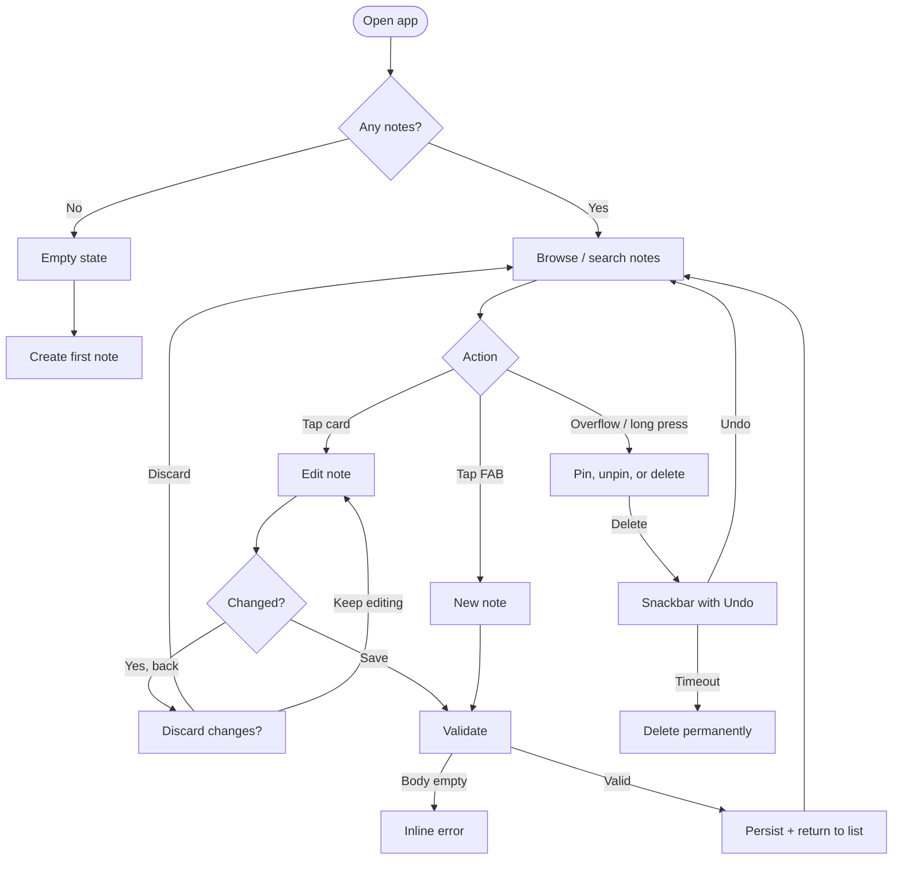

# My Notes — UI/UX Refactoring & Optimization Plan

**Status:** v1 redesign, v2 tasks/reminders/settings/backup, and the fluidity pass (autosave, transitions, skeleton loading, pin animation) implemented; core flows validated on an Android 14 emulator  
**Scope:** The Android app in this repository (Java + XML, Material 3, minSdk 24, targetSdk 34)  
**Skills applied:** `ui-ux-designer` (tokens, flows, component states, accessibility), `ui-visual-validator` (evidence-based visual QA), `taste-skill` / `design-taste-frontend` (design read, anti-slop direction, typography and layout discipline)

> **Implementation note (October 2026).** The v1 design system, list, state views, editor, pin sorting, delete undo, responsive dimensions, and conditional inset handling are implemented. The v2 increment adds the Notes/Tasks shell, task data and editor, due dates and reminders, Settings, and JSON backup/restore. Room is now version 3 with an exported schema and a tested `MIGRATION_2_3`; `fallbackToDestructiveMigration()` remains removed. API 30+ uses edge-to-edge with cutout/system-bar/IME padding; API 24–29 keeps fitted system windows because `adjustResize` is more reliable there. The fluidity pass adds debounced note autosave with draft recovery, shared-element editor transitions, a tab fade, skeleton loading cards, and a pin confirmation animation; all motion is gated by the system animation scale. Validation covered phone and tablet widths, light/dark themes, 200% font scale, reminder delivery, boot rescheduling, and backup/restore on an Android 14 emulator. A physical-device TalkBack walkthrough remains the final optional hardware check.

| Skill | Applied in this plan |
| :--- | :--- |
| `ui-ux-designer` | §3 flows and information architecture; §4 token architecture, component specs, state matrix, accessibility; §6 responsive requirements |
| `ui-visual-validator` | §2 evidence-based audit; §7 phase gates; §8 screenshot matrix, measurement protocol, verdict and pass criteria |
| `taste-skill` / `design-taste-frontend` | §1 design read and dials; §4 anti-slop palette and typography; §10 risk/anti-slop guardrails |

---

## 0. Executive summary

My Notes already has the right feature set for a lightweight notes app: quick creation, local Room persistence, search, pinning, and deletion. The audit below records the pre-refactor baseline and is kept as evidence; the implementation note above describes what shipped.

The original interface looked and behaved like an early prototype:

- The palette is pure black, saturated purple, and **20 defined card colours** (9 of which are picked at random) that change every time a row is recycled.
- The list uses a **fixed `400dp × 561dp` RecyclerView** inside a `RelativeLayout`, so it clips on narrow phones and leaves dead space on larger ones.
- Search hint text is a light lavender-grey on purple at **≈1.97:1 contrast**, and 3 of the 20 card colours fail AA with black text.
- There is no empty state, no “no search results” state, no loading/error state, no save affordance label, and no undo after deletion.
- Actions such as pin/delete are hidden behind a long press, and the save icon is a 40dp unlabelled bookmark.
- The theme is declared `DayNight`, but both activities hard-code a black background and black status bar, so light mode is effectively broken.

The plan below turns this into a calm, content-first “quiet paper” experience without migrating away from Java/XML:

1. Replace the random palette and ad-hoc sizes with **semantic design tokens**.
2. Rebuild the list and editor screens around **Material 3 components, correct insets, and adaptive grids**.
3. Make every state explicit: empty, search-empty, loading, error, dirty editor, save validation, delete-undo.
4. Fix accessibility at the component level: contrast, 48dp targets, content descriptions, TalkBack actions, dynamic type, RTL.
5. Validate with a repeatable **screenshot + measurement protocol** and a written visual verification report.

### Guiding constraints

- **Do not migrate to Compose in this pass.** Keep Java + XML and the existing Room model. The refactor should be reviewable and shippable incrementally.
- **Preserve the core flow:** open list → create/edit note → save → search/pin/delete.
- **No new backend, account, or cloud dependency.** Local-first remains the product promise.
- **Any Room schema change needs a migration.** The original `fallbackToDestructiveMigration()` silently wiped notes; it has been removed. The schema is now version 3 after the tasks table was added, with a tested 2→3 migration. Future schema changes must ship a migration too.

---

## 1. Design read and dials

> **Reading this as:** a consumer/prosumer note-taking Android app for everyday quick capture, with a calm, tactile “quiet paper” language, leaning toward Material 3 components with a restrained indigo accent, not a generic AI-purple dashboard.

### 1.1 Dials

| Dial | Value | Why |
| :--- | :---: | :--- |
| `DESIGN_VARIANCE` | **5** | Notes are scanned quickly. Keep a predictable grid and left-aligned hierarchy; introduce personality through type, spacing, and colour rather than asymmetry. |
| `MOTION_INTENSITY` | **3** | Standard Material transitions, ripple, and Snackbar only. No scroll hijacking or perpetual animation. |
| `VISUAL_DENSITY` | **5** | Comfortable phone density: 16dp screen margins, 12dp card gutters, 16dp card padding. |

### 1.2 Anti-slop decisions

- **No pure black.** Use a warm near-black `#121110` for dark mode and a warm off-white `#F7F5F2` for light mode.
- **One accent.** A deep indigo `#4F46B8` replaces both the loud `#643BF7` and the candy-card palette. It is used only for the FAB, focus rings, active pin indicators, and selected states.
- **No random colour.** Card surfaces are neutral by default. If per-note colour returns later, it must be user-chosen, persisted, muted, and contrast-checked — never generated in `onBindViewHolder()`.
- **No giant hero title.** The 35sp purple wordmark becomes a 28sp ink-coloured page title with a quiet note count. Content gets the visual weight.
- **No decorative glass, gradients, or glow.** Paper-like surfaces, 1dp outlines, and typography do the work.
- **No marquee dates.** Dates are static metadata, never scrolling text.

---

## 2. Current-state audit

### 2.1 Screen inventory

| Screen / state | Current implementation | Exists? |
| :--- | :--- | :---: |
| Notes list | `MainActivity`, `activity_main.xml`, `note_list.xml` | Yes |
| Note editor (new/edit) | `NotesTakeActivity`, `activity_notes_take.xml` | Yes |
| Search | `SearchView` filter over in-memory list | Yes |
| Empty list | Blank black screen + FAB | **No** |
| No search results | Blank area | **No** |
| Loading | None (Room read on main thread) | **No** |
| Error | Crash / silent failure | **No** |
| Delete undo | Immediate delete + toast | **No** |
| Discard unsaved changes | System back only | **No** |
| Pin/delete menu | Long-press `PopupMenu` | Yes, hidden |

### 2.2 Findings by visual-audit dimension

| # | Severity | Dimension | Finding | Evidence | Fix phase |
| :---: | :---: | :--- | :--- | :--- | :---: |
| 1 | **High** | Colour | Card background is randomly selected from 9 of the 20 defined colours in `onBindViewHolder()`, so the same note changes colour while scrolling. | `NoteListAdapter#getRandomColor()`; `Arch install` is orange in `ui-demo3.jpg` and yellow in `ui-demo4.jpg`. | 3 |
| 2 | **High** | Colour / a11y | Black text on `#C10059`, `#AB3D3D`, and `#AF0072` is **3.41:1, 3.47:1, 3.07:1** — below AA for normal text. | `colors.xml` + fixed `@color/black` text. | 2–3 |
| 3 | **High** | Colour / a11y | Search hint is a light lavender-grey (`#C7ADF5` sampled from the screenshot) on `#906FD6`: **≈1.97:1**; the placeholder is barely readable. | `activity_main.xml`; `ui-demo1.jpg`. | 1–2 |
| 4 | **High** | Layout | RecyclerView is hard-coded to `400dp × 561dp`; on a 360dp-wide phone it overflows horizontally and on tall screens it stops short. | `activity_main.xml` lines 45–52. | 2 |
| 5 | **High** | Accessibility | Save control is a 40dp `ImageView` with no `contentDescription`; pin icon is 25dp and unlabelled. | `activity_notes_take.xml`, `note_list.xml`. | 3–4 |
| 6 | **High** | States | No empty, no-results, loading, or error state. First launch is a blank black screen. | `MainActivity` only toggles adapter data. | 2 |
| 7 | **High** | Colour | Pure `#000000` canvas and saturated `#643BF7` title cause harsh OLED contrast and do not match the declared `DayNight` theme. | `activity_main.xml`, `activity_notes_take.xml`, `MainActivity#onCreate`, `NotesTakeActivity#onCreate`. | 1 |
| 8 | **Medium** | Layout / responsive | 2-column `StaggeredGridLayoutManager` is fixed; no tablet or landscape adaptation. | `MainActivity#updateRecycle`. | 2 |
| 9 | **Medium** | Typography | Four unrelated scales: 35sp black header, 23sp condensed card title, 19sp body, 13sp marquee date. No line-height or max-line policy. | Layout XML. | 1–3 |
| 10 | **Medium** | Typography | Date uses `ellipsize="marquee"` + `setSelected(true)`; screenshots show clipped/mid-scroll dates such as `25 18:42 PM` and `Mon, 17 Mar 2…`. | `note_list.xml`; `NoteListAdapter#onBindViewHolder`. | 3 |
| 11 | **Medium** | States | Save/back has no dirty-state handling; system back silently discards edits. | `NotesTakeActivity`. | 4 |
| 12 | **Medium** | Feedback | Delete is immediate, with a toast and no undo. Pin toast says “Starred/Unstarred” while the menu says “Pin/UnPin”. | `MainActivity#onMenuItemClick`. | 5 |
| 13 | **Medium** | Layout / a11y | Editor fields use fixed heights (`74dp`, `231dp`); content is not scrollable above the keyboard; no `adjustResize`. | `activity_notes_take.xml`, manifest. | 4 |
| 14 | **Medium** | A11y / dynamic type | Fixed heights and 35sp/23sp type will clip at 1.3×–2.0× font scale. | Layout XML. | 6 |
| 15 | **Medium** | Information architecture | Pinned notes are not sorted first; pinning does not surface the note. | DAO orders by `id DESC` only. | 5 |
| 16 | **Low** | Consistency | Theme uses Material 3, but UI uses `CardView` and unstyled `SearchView`; no Material 3 tokens. | `themes.xml`, layouts. | 1–3 |
| 17 | **Low** | Performance / UX | `notifyDataSetChanged()`, full list reloads, and random colours on bind cause flicker and lose scroll position. | `MainActivity`, `NoteListAdapter`. | 3, 6 |
| 18 | **Low** | Copy | Hard-coded strings, no plurals, menu wording mixes pin/star metaphors. | Java + XML. | 1, 5 |

### 2.3 Current contrast audit

| Element | Foreground | Background | Ratio | WCAG AA |
| :--- | :--- | :--- | :---: | :---: |
| Search hint (sampled) | `#C7ADF5` | `#906FD6` | **1.97:1** | **FAIL** |
| Card text — magenta | `#000000` | `#C10059` | **3.41:1** | **FAIL** |
| Card text — dark red | `#000000` | `#AB3D3D` | **3.47:1** | **FAIL** |
| Card text — wine | `#000000` | `#AF0072` | **3.07:1** | **FAIL** |
| Card text — blue | `#000000` | `#396FDB` | 4.47:1 | Pass (marginal) |
| Header title | `#643BF7` | `#000000` | 3.51:1 | Pass as large text, fails AAA |
| Card text — pink | `#000000` | `#E694FF` | 10.04:1 | Pass |

> The random palette is not inherently bad because it is colourful; it is bad because **contrast and meaning are left to chance**.

### 2.4 Lint baseline

`make lint` currently succeeds with **0 errors and 69 warnings**. The warnings that overlap this plan are:

- **9 × `HardcodedText`** — layout strings such as “My Notes”, “Title”, “Add Notes”, “Pin/UnPin”, “Delete”.
- **5 × `NotifyDataSetChanged`** — adapter updates that should become `DiffUtil`/specific change events.
- **3 × `ContentDescription`** — unlabelled images (save, pin, etc.).
- **2 × `TextFields`** — `EditText` fields without an `inputType`.
- **2 × `Overdraw`** — the black root background painted over the theme background.
- **2 × `DefaultLocale`** — `toLowerCase()` in the search filter (also a correctness issue for Turkish locales).
- **14 × `UnusedResources`** — including `color10`–`color20`, which the adapter never references, and `baseline_cloud_done_24`.

These are useful acceptance targets: the refactor should not add new lint warnings and should eliminate the in-scope ones.

### 2.5 What to keep

- The one-screen list + one-screen editor flow is correct and should stay.
- Room persistence, local-first operation, search, pinning, and deletion are the right feature set.
- The FAB is the right primary action for this app.
- A dark theme suits the product; the task is to make it intentional rather than accidental.
- The existing screenshots are useful as a “before” baseline in the final visual report.

---

## 3. Target experience

### 3.1 Experience principles

1. **Capture first.** A new note is two taps from the list and one tap from the empty state.
2. **Content before chrome.** The note text, not a purple banner, is the loudest thing on screen.
3. **Quiet confidence.** Neutral surfaces, one accent, clear type hierarchy, no decorative noise.
4. **Nothing disappears without a way back.** Delete has undo; back from a dirty editor asks first.
5. **Readable by everyone.** AA contrast, 48dp targets, TalkBack actions, 200% text, RTL.
6. **Stable while scrolling.** A note’s colour, order, and metadata never change just because it was recycled.

### 3.2 Primary user flows



### 3.3 Information architecture

- **List screen**
  - Page title + note count.
  - Search field.
  - Responsive note grid (pinned first).
  - Primary FAB: new note.
  - Card overflow: pin/unpin, delete.
- **Editor screen**
  - Back (with dirty check).
  - “New note” / “Edit note” title.
  - Save action (disabled until body has content).
  - Title field + body field.
  - Last-edited metadata.
- **Transient surfaces**
  - Delete Snackbar with Undo.
  - Discard-changes dialog.
  - Empty state and no-results state.
  - Error state with retry.

### 3.4 Low-fidelity wireframes

**List — content**

```text
┌──────────────────────────────────────────┐
│  My Notes                        12 notes│  28sp title, 12sp count
│  ┌────────────────────────────────────┐  │
│  │ [search]  Search notes        [x]  │  │  56dp, 28dp radius
│  └────────────────────────────────────┘  │
│  ┌────────────────┐  ┌────────────────┐  │
│  │ Title          │  │ Pinned title   │  │
│  │ Preview text…  │  │ Preview text…  │  │
│  │ [pin] Apr 18 ⋮ │  │ Apr 12       ⋮ │  │
│  └────────────────┘  └────────────────┘  │
│  ┌────────────────┐  ┌────────────────┐  │
│  │ …              │  │ …              │  │
│  └────────────────┘  └────────────────┘  │
│                                  [+ New] │  56dp FAB, 16dp inset
└──────────────────────────────────────────┘
```

**List — empty**

```text
┌──────────────────────────────────────────┐
│  My Notes                                │
│  ┌────────────────────────────────────┐  │
│  │ [search]  Search notes             │  │
│  └────────────────────────────────────┘  │
│                                          │
│              [note outline]              │
│               No notes yet               │
│      Capture a thought before it slips    │
│                away.                     │
│           [ Create first note ]          │
│                                          │
│                                  [+ New] │
└──────────────────────────────────────────┘
```

**List — no search results**

```text
│              [search outline]            │
│         No notes match “arch”            │
│   Try a different word, or clear the      │
│                search.                    │
│              [ Clear search ]            │
```

**Editor**

```text
┌──────────────────────────────────────────┐
│ [<-]  New note                     Save  │  64dp app bar
│                                          │
│  Title                                   │  24sp title field
│  ──────────────────────────────────────  │
│  Start writing…                           │  17sp / 28 line height
│                                          │
│                                          │
│                                          │
│                              Edited 19:42│  12sp metadata
└──────────────────────────────────────────┘
```

**Delete feedback**

```text
┌──────────────────────────────────────────┐
│ Note deleted                        UNDO │  inverse surface
└──────────────────────────────────────────┘
```

---

## 4. Design system

### 4.1 Token architecture

Use the W3C-style three-layer model, mapped to Android resources:

```text
Primitive tokens        values/colors.xml          stone_50, stone_900, indigo_600 …
        │
        ▼
Semantic tokens         values/colors.xml          surface_canvas, text_primary, accent …
                        values-night/colors.xml    dark replacements for the same names
        │
        ▼
Component tokens        values/styles.xml          NoteCard, SearchField, EditorAction …
                        layout attributes          ?attr/colorSurface, @dimen/space_4
```

Rules:

- Layouts and Java refer to **semantic** tokens, never raw hex values.
- `values-night` overrides semantic names only; primitives stay in `values`.
- No colour literal appears in a layout except `@null`/transparent.
- No `android:textSize` literal in layouts; use `TextAppearance` styles.

### 4.2 Colour tokens

| Semantic token | Light | Dark | Use |
| :--- | :--- | :--- | :--- |
| `surface_canvas` | `#F7F5F2` | `#121110` | Window background |
| `surface_panel` | `#FFFDFA` | `#1D1B19` | Note card, search field |
| `surface_variant` | `#EFEAE4` | `#2A2724` | Search background, pressed surfaces |
| `surface_inverse` | `#2F2B27` | `#F2EEE8` | Snackbar |
| `text_primary` | `#1B1A17` | `#F2EEE8` | Titles, note body |
| `text_secondary` | `#5E5A54` | `#B7B0A6` | Dates, hints, counts |
| `text_inverse` | `#F7F5F2` | `#1B1A17` | Snackbar text |
| `accent` | `#4F46B8` | `#B9B2FF` | FAB, focus, active pin |
| `on_accent` | `#FFFDFA` | `#221C5C` | Text/icon on accent |
| `accent_container` | `#E8E3FF` | `#332C6B` | Selection, pin chip |
| `on_accent_container` | `#221C5C` | `#E8E3FF` | Text on container |
| `outline_interactive` | `#7A7368` | `#777067` | 1dp card/search boundary |
| `divider` | `#DCD5CA` | `#3A3530` | Decorative separators only |
| `danger` | `#B3261E` | `#F2B8B5` | Delete action/error |
| `on_danger` | `#FFFDFA` | `#601410` | Text on danger |

**Note tints (optional, phase 4+):** if users can choose a note colour, use six muted tints — lavender `#E8E3FF`, sage `#E3EBDD`, sand `#F4E8D2`, rose `#F7E2E5`, sky `#DEEAF6`, clay `#F3E3DA`; dark equivalents `#2B2740`, `#28352A`, `#3A3324`, `#3D2A2E`, `#253341`, `#3A2E27`. Store the chosen index in Room. Never derive it from a random number, and never regenerate it on bind.

> The current 20-colour palette (`color1`–`color20`, of which `color1`–`color9` are used by the adapter) should be deleted. If a future release wants note colours, it starts from the six tint tokens above, not the old list.

### 4.3 Target contrast audit

| Pair | Ratio | Requirement | Result |
| :--- | :---: | :--- | :---: |
| Primary text / light canvas | 15.99:1 | AA / AAA body | Pass |
| Primary text / light panel | 17.14:1 | AA / AAA body | Pass |
| Primary text / dark canvas | 16.32:1 | AA / AAA body | Pass |
| Primary text / dark panel | 14.86:1 | AA / AAA body | Pass |
| Secondary text / light panel | 6.74:1 | AA body | Pass |
| Secondary text / dark panel | 7.99:1 | AA body | Pass |
| On-accent / accent (light FAB) | 7.13:1 | AA body | Pass |
| Dark on-accent / dark accent (dark FAB) | 7.83:1 | AA body | Pass |
| Accent / light canvas | 6.65:1 | AA body | Pass |
| Accent / dark canvas | 9.77:1 | AA body | Pass |
| Interactive outline / light panel | 4.62:1 | 3:1 UI component | Pass |
| Interactive outline / dark panel | 3.51:1 | 3:1 UI component | Pass |
| Interactive outline / light search fill | 3.92:1 | 3:1 UI component | Pass |
| Interactive outline / dark search fill | 3.04:1 | 3:1 UI component | Pass |
| Danger / light panel | 6.44:1 | AA body | Pass |
| Note tint / ink text (all six, light) | ≥ 13.9:1 | AA body | Pass |
| Note tint / ink text (all six, dark) | ≥ 10.8:1 | AA body | Pass |

### 4.4 Typography

Use the system sans (Roboto on Android). Personality comes from weight, size, and spacing, not a novelty font.

| Token / style | Size / line height | Weight | Use |
| :--- | :--- | :--- | :--- |
| `TextAppearance.MyNotes.Display` | 32sp / 40sp, tracking `-0.5` | Medium | Empty-state title if needed |
| `TextAppearance.MyNotes.Headline` | 28sp / 36sp, tracking `-0.25` | Medium | “My Notes” page title |
| `TextAppearance.MyNotes.TitleLarge` | 22sp / 28sp | Medium | Editor app-bar title, dialog title |
| `TextAppearance.MyNotes.Title` | 16sp / 24sp | Medium | Note title, field label |
| `TextAppearance.MyNotes.Body` | 16sp / 24sp | Regular | Body copy, search input |
| `TextAppearance.MyNotes.BodySmall` | 14sp / 20sp | Regular | Note preview, helper text |
| `TextAppearance.MyNotes.Label` | 12sp / 16sp, tracking `0.4` | Medium | Dates, note count, metadata |
| `TextAppearance.MyNotes.EditorTitle` | 24sp / 32sp | Medium | Note title field |
| `TextAppearance.MyNotes.EditorBody` | 17sp / 28sp | Regular | Note body field |

Rules:

- No `sans-serif-condensed` or `sans-serif-black`; both are display tricks that fight the content.
- Body copy stays at 16sp minimum; metadata may be 12sp but never essential content.
- Use `android:lineSpacingMultiplier` or `lineHeight` (API 28+) through the text appearances.
- Limit titles to two lines and previews to four in cards; editor fields are unbounded and scroll.
- No marquee. No all-caps except a single small label if truly needed.

### 4.5 Spacing, shape, elevation

| Token | Value | Use |
| :--- | ---: | :--- |
| `space_1` | 4dp | Icon-to-label, tight gaps |
| `space_2` | 8dp | Chip gaps, compact padding |
| `space_3` | 12dp | Grid gutters, metadata gaps |
| `space_4` | 16dp | Screen margin, card padding |
| `space_6` | 24dp | Section spacing, tablet margin |
| `space_8` | 32dp | Empty-state vertical rhythm |
| `space_12` | 48dp | Minimum touch target |
| `space_16` | 64dp | App-bar height |

**Shape scale:** cards `16dp`; search field `28dp`; buttons/FAB use Material defaults (`20dp`/`16dp`); dialogs/sheets `28dp`; chips `8dp`. This is a documented mixed system: containers are soft rectangles, inputs are pills, actions use Material shape.

**Elevation:** cards use `0dp` elevation with a 1dp `outline_interactive` border. Dark mode uses a lighter surface, not heavier shadow. FAB and Snackbar are the only floating layers.

### 4.6 Component specifications

#### Notes top bar

- **Intent:** Identify the screen and show volume without competing with notes.
- **Anatomy:** 28sp title “My Notes” + optional 12sp count aligned to the title baseline; 16dp start/end padding; 64dp height.
- **Tokens:** `text_primary`, `space_4`, `space_16`.
- **States:** static; scrolls with content or stays fixed (choose fixed for one-screen list).
- **A11y:** title is a heading via `AccessibilityNodeInfoCompat.setHeading(true)` if available; count is read as “12 notes”.

#### Search field

- **Intent:** Filter notes quickly without turning the screen into a banner.
- **Anatomy:** filled input, 56dp high, 28dp radius, 1dp border; leading search glyph 20dp; hint “Search notes”; trailing clear button visible only when text is non-empty.
- **Tokens:** `surface_variant` (or `surface_panel`), `text_primary`, `text_secondary`, `accent` focus ring, `space_4`.
- **States:** default, focused (2dp accent outline + cursor), filled (clear visible), empty results (handled by page state).
- **Interaction:** `imeOptions="actionSearch"`, debounce 200ms, clear keeps focus and refilters; query survives rotation.
- **A11y:** 48dp clear target; `contentDescription="Clear search"`; placeholder is a hint, not a label — pair with an invisible/visible label if needed for TalkBack.

#### Note card

- **Intent:** Preview a note and expose open/pin/delete actions.
- **Anatomy:** `MaterialCardView`; optional 3dp pinned accent bar at the start edge; title (2 lines max); body preview (4 lines max); metadata row with pin glyph + date + overflow button.
- **Tokens:** `surface_panel`, `outline_interactive` 1dp, radius `16dp`, padding `space_4`; title `Title`, body `BodySmall`, metadata `Label`; pinned bar/glyph `accent`.
- **States:** default, pressed (ripple, no layout shift), focused (2dp accent ring for keyboard/switch access), pinned (bar + glyph + content description), long-pressed (same menu as overflow).
- **Interaction:** tap opens editor; overflow opens menu; long press opens the same menu as a shortcut.
- **A11y:** card is focusable and clickable; custom actions “Pin note”/“Unpin note” and “Delete note”; do not put a single `contentDescription` on the container (it would hide the title/body). Pin icon description “Pinned”; overflow “Note actions”.
- **Data:** title fallback “Untitled”; date fallback “No date”. No random colours.

#### FAB

- **Anatomy:** 56dp standard FAB, plus icon, 16dp from end/bottom insets.
- **Tokens:** `accent`, `on_accent`, shape `16dp`.
- **States:** default, pressed (Material ripple/elevation), focused, hidden? Keep visible; list has 96dp bottom padding so the last card can scroll clear.
- **A11y:** `contentDescription="New note"`; tooltip on long press for pointer users.

#### Empty state

- **Anatomy:** 96dp line illustration (note + pencil), 22sp title, 14sp supporting copy (max 2 lines), filled “Create first note” button.
- **Tokens:** `text_primary`, `text_secondary`, `accent`, max width 320dp, centered vertically in the content area.
- **States:** list-empty and search-empty variants.
- **A11y:** icon is decorative (`importantForAccessibility="no"`); heading semantics on title; button is a real `MaterialButton`.

#### Editor app bar

- **Anatomy:** 64dp `MaterialToolbar`; back arrow 48dp target; title “New note” or “Edit note”; text “Save” action, min 48dp height, disabled until body has content.
- **Tokens:** `surface_canvas`, `text_primary`, `accent` for enabled Save, `text_secondary` when disabled.
- **States:** default, pressed, focused, disabled (empty body), saving (disable + progress in action).
- **A11y:** back “Navigate up”; Save has visible text, so no icon-only ambiguity; state changes announced.

#### Editor fields

- **Anatomy:** title `EditText` 24sp medium, hint “Title”, 2 lines max; body `EditText` 17sp/28, hint “Start writing…”, fills remaining height, scrolls.
- **Tokens:** transparent background, `text_primary`, `text_secondary` hint, `accent` cursor/underline focus; no fixed pixel heights.
- **States:** default, focused, error (empty body), disabled? no.
- **A11y:** labels/hints; body supports keyboard resizing; error text below body and announced; editor max width 720dp on tablets.

#### Overflow menu

- **Anatomy:** `PopupMenu` anchored to the card overflow: “Pin”/“Unpin” and “Delete note”.
- **Tokens:** `surface_panel`, `text_primary`, `danger` for Delete if platform styling permits; icons 20dp.
- **States:** default, pressed, destructive; no disabled state.
- **A11y:** menu items have text labels; icons are decorative. For destructive styling, use a `SpannableString` with `ForegroundColorSpan(danger)` if the popup does not theme item text; otherwise keep a delete confirmation dialog.

#### Snackbar / undo

- **Anatomy:** inverse surface, 14sp message, action “UNDO”, 5s duration, anchored above FAB.
- **States:** visible, action pressed, dismissed.
- **Behaviour:** delete removes the note from the UI immediately but defers the DB delete until the Snackbar is dismissed; Undo cancels the pending delete and restores the card. Announce “Note deleted. Undo available.”
- **A11y:** Snackbar is announced; Undo target is at least 48dp.

#### Dialog

- **Anatomy:** `MaterialAlertDialogBuilder` with title, body, “Keep editing” and “Discard” actions.
- **Use:** only for unsaved changes. Delete uses undo instead of a confirmation dialog.
- **A11y:** focus lands on the dialog title; destructive action is last in traversal order.

### 4.7 Motion

- Use standard Material activity transitions and ripple feedback. Note editing uses a shared-element transition from the tapped card into the editor root; new notes use a short rise/fade. Return uses the reverse shared-element transition.
- Card press: ripple only; no scale transform that can clip in a staggered grid.
- Pin confirmation: a 220ms scale/fade on the pin glyph; list reordering still uses `DiffUtil`.
- Delete: Snackbar slides in from the bottom; undo restores with a short fade/slide, not a bounce.
- Loading: three to six skeleton cards (matching the active grid span) pulse gently instead of showing a spinner.
- Respect system animation scale: read `Settings.Global.ANIMATOR_DURATION_SCALE` (works on API 24+) or guard `ValueAnimator.areAnimatorsEnabled()` with API 26+; do not run infinite skeleton shimmer or shared-element transitions when animations are disabled.
- No auto-playing marquee, parallax, or looping motion.

### 4.8 Iconography and assets

- Use Material Symbols/vector drawables at 24dp with 1.5–2dp stroke consistency: search, clear, more-vert, arrow-back, pin, note, add, delete.
- Set `android:autoMirrored="true"` on directional icons (back arrow).
- Add content descriptions on every icon button; mark decorative icons `importantForAccessibility="no"`.
- Remove unused assets (`baseline_cloud_done_24.xml` is not referenced) and give the remaining files semantic names (`ic_search_24.xml`, `ic_pin_24.xml`, etc.).
- Keep the launcher icon; do not add a generic AI-generated hero illustration. A simple line-art note glyph is enough for the empty state.

---

## 5. Screen-by-screen refactor

### 5.1 `activity_main.xml`

**Replace** the `RelativeLayout` + fixed-size RecyclerView with:

```text
CoordinatorLayout
├── AppBarLayout / constrained header
│   ├── TextView  “My Notes” + count
│   └── TextInputLayout + TextInputEditText (search)
├── FrameLayout (content state container)
│   ├── RecyclerView  (0dp × 0dp, constrained below search)
│   ├── EmptyStateView (list-empty)
│   ├── EmptyStateView (search-empty)
│   ├── LoadingSkeleton (3 skeleton cards)
│   └── ErrorStateView
├── FloatingActionButton  (bottom-end, insets-aware)
└── (Snackbar anchor)
```

Key implementation notes:

- RecyclerView uses `layout_width="match_parent"`, `layout_height="0dp"` with a constraint to the bottom, and `clipToPadding="false"` + 96dp bottom padding so the FAB never covers the last row.
- `StaggeredGridLayoutManager` span count comes from `@integer/note_grid_span` (`2` default, `3` in `values-sw600dp`, `3` in `values-land`, `4` in `values-sw840dp`).
- Use `WindowInsetsCompat` to pad the root for status/navigation bars and to offset the FAB above the IME if needed. Do not hard-code status bar colour.
- Add a state container/`ViewSwitcher` (or simple visibility logic) for `loading`, `content`, `empty`, `search-empty`, `error`.
- No `android:background="@color/black"`; use `?attr/colorSurface`/`surface_canvas` via theme.
- Add a content transition (fade) between empty and content; no layout animation on every DB change.

### 5.2 `note_list.xml` / note card

**Replace** `androidx.cardview.widget.CardView` with `com.google.android.material.card.MaterialCardView`:

- `app:cardCornerRadius="16dp"`, `app:cardElevation="0dp"`, `app:strokeWidth="1dp"`, `app:strokeColor="@color/outline_interactive"`, `app:cardBackgroundColor="@color/surface_panel"`.
- Padding `16dp`; inner `ConstraintLayout`.
- Optional 3dp pinned bar: a `View` at start edge, width 3dp, height match_parent, `accent`, visible only when pinned.
- Title: `TextView` `textAppearance="@style/TextAppearance.MyNotes.Title"`, `maxLines="2"`, `ellipsize="end"`.
- Preview: `BodySmall`, `maxLines="4"`, `ellipsize="end"`.
- Metadata row: 14dp pin glyph (only when pinned) + date `Label`, `maxLines="1"`; overflow `ImageButton` 48dp square with 24dp icon.
- Card `android:clickable="true"`, `android:focusable="true"`, `android:foreground="?attr/selectableItemBackground"` (or `MaterialCardView` ripple), `android:minHeight="120dp"`.
- No random background. No heavy `8dp` elevation. No marquee.

### 5.3 `activity_notes_take.xml`

**Replace** linear fixed heights with:

```text
CoordinatorLayout
├── MaterialToolbar (back, title, Save action)
└── NestedScrollView (fillViewport, constrained below toolbar)
    ├── LinearLayout / ConstraintLayout (max width 720dp, centered)
    │   ├── EditText title (EditorTitle, hint)
    │   ├── View divider (optional, divider colour)
    │   ├── EditText body (EditorBody, fill remaining, gravity top)
    │   └── TextView metadata (“Edited …”)
```

Key notes:

- `android:windowSoftInputMode="adjustResize"` in `AndroidManifest.xml`.
- Use `ViewCompat.setOnApplyWindowInsetsListener` to add IME bottom padding; the body scrolls above the keyboard.
- No fixed `231dp` body height; `minHeight` and `layout_weight`/constraints let it grow.
- Save is a `MaterialButton` text action in the toolbar, 48dp min height; use `android:enabled` bound to body length.
- Back arrow triggers dirty check; system back uses `OnBackPressedDispatcher` with the same callback.
- Title blank is allowed and saved as “Untitled”; body blank is blocked with inline helper/error and focus moved to the body.
- Show “Edited just now”/timestamp only when editing; new notes show a subtle “Draft” label? Keep it simple: date only on save.

### 5.4 `MainActivity` / `NotesTakeActivity` state changes

- Add a small UI-state model (enum or sealed-like class in Java) for list: `LOADING`, `CONTENT`, `EMPTY`, `SEARCH_EMPTY`, `ERROR`.
- Search query is a field in `onSaveInstanceState` or a `ViewModel`; filtering happens against a single source list, not a mutable adapter copy.
- Sort pinned notes first, then by last modified/ID descending. When pinning, update in place and scroll to the pinned note if it moved.
- Delete: keep a `pendingDelete` reference; show Snackbar; commit DB delete on dismissal, cancel on Undo. If the activity is destroyed, commit immediately to avoid resurrection ambiguity.
- Pin copy: “Pinned” / “Unpinned”; icon is a pin, not a star. Remove the “Starred” toast.
- Return from editor: insert/update at the top if it is the most recent; preserve scroll if editing an older note unless the user expects a jump. New notes scroll to top.
- Use the Activity Result API (`registerForActivityResult`) instead of deprecated `startActivityForResult`; this is a supporting refactor for reliable state return.

### 5.5 Data/UI enablers (supporting, not visual scope)

These are not required to make the first visual improvement, but they remove the main causes of UI instability:

- Replace `notifyDataSetChanged()` with `ListAdapter` + `DiffUtil.ItemCallback`; stable IDs; update one item for pin, remove one for delete.
- Move Room calls off the main thread; expose `LiveData<List<Notes>>` or use an executor; remove `allowMainThreadQueries()`.
- Store a timestamp (`Long updatedAt`) in addition to/instead of the formatted date string; format for display (“Today, 19:42”, “18 Apr 2025”). If the schema changes, add a Room migration and **do not** ship `fallbackToDestructiveMigration()`.
- Debounce search by 200ms; cancel pending filters when the query clears.
- Remove the `getAdapterPosition()` usage in the adapter click listeners; use `getBindingAdapterPosition()` and guard `NO_POSITION`.
- Remove `getRandomColor()` and the `color1`–`color20` resources entirely.

---

## 6. Accessibility and responsive requirements

### 6.1 Accessibility acceptance criteria

- [ ] All normal text ≥ 4.5:1; large text ≥ 3:1; UI boundaries/focus rings ≥ 3:1. Target table in §4.3 passes.
- [ ] Every interactive element has a ≥ 48dp × 48dp touch target (save, back, overflow, clear, pin, FAB, menu items).
- [ ] Every icon-only control has a meaningful `contentDescription`; decorative icons are hidden from TalkBack.
- [ ] Note cards expose custom accessibility actions for Pin/Unpin and Delete.
- [ ] TalkBack reads a card as title → preview → date/pinned → actions; no duplicate or empty focus stops.
- [ ] State changes are announced: note saved, note deleted with Undo, pin state changed, search result count/no results.
- [ ] Type scale 1.0, 1.3, and 2.0: no clipped titles, no overlapping FAB, no unreachable Save, no fixed-height clipping.
- [ ] RTL: all horizontal margins/paddings use start/end; back arrow is auto-mirrored; layout at Arabic locale does not break.
- [ ] Colour is not the only indicator: pin has icon + bar + accessible label.
- [ ] Keyboard/switch access: focus order is title → search → cards → FAB; focus rings are visible; Enter/Space activates cards and buttons.
- [ ] Motion respects system animation settings; no essential information is conveyed only through animation.
- [ ] `lintDebug` has no new `ContentDescription`, `TouchTargetSize`, `HardcodedText`, or `SmallSp` errors.

### 6.2 Responsive matrix

| Viewport | Columns | Margins | Notes |
| :--- | :---: | :---: | :--- |
| 320–399dp phone | 2 | 16dp | Smallest supported; verify no horizontal clipping |
| 400–599dp phone | 2 | 16dp | Standard target |
| 600–839dp tablet | 3 | 24dp | Editor max width 720dp |
| ≥ 840dp tablet | 4 | 32dp | Content max width 1200dp, centered |
| Phone landscape | 3 | 16dp | Verify FAB and Snackbar insets |
| Font scale 2.0 | 1–2 | 16dp | Cards may grow; no fixed heights |

Add `values-sw600dp/dimens.xml`, `values-sw840dp/dimens.xml`, and `values-land/integers.xml`; do not compute columns with magic numbers in Java.

### 6.3 Light/dark decision

The app currently declares `Theme.Material3.DayNight` but hard-codes black. The plan commits to **both modes**, following the system:

- Remove `getWindow().setStatusBarColor(...)` from both activities.
- Set `android:statusBarColor`/`navigationBarColor` to transparent and use `WindowInsetsControllerCompat` for icon appearance. Use `WindowCompat.setDecorFitsSystemWindows(window, false)` plus `WindowInsetsCompat` (or `enableEdgeToEdge()` if the Activity dependency is available).
- Create `values-night/colors.xml` overrides for all semantic tokens.
- Test both modes at every phase. If the product intentionally wants dark-only, remove `DayNight` and delete light tokens; do not ship a half-broken light theme.

---

## 7. Implementation phases

Estimates are for one developer familiar with Android/Java; they include implementation and self-review, not the final QA buffer.

### Phase 0 — Baseline and guardrails (0.5 day)

- Build the current APK from the CLI (`make debug`).
- Capture “before” screenshots at 360×800, 393×852, 412×915, 800×1280, light/dark, empty/content/search/editor.
- Record current contrast and touch-target failures (already in §2.2–2.3).
- Run `make lint` and archive the baseline warning count (currently 69 warnings, 0 errors).
- Add the screenshot/validation folder structure (e.g. `docs/validation/before/`).
- Confirm the build is reproducible on Arch without Android Studio.

**Exit:** baseline evidence exists; no code changes yet.

### Phase 1 — Tokens, theme, and strings (1 day)

- Add semantic colours (light + night), dimens, text appearances, integer grid spans, component styles.
- Update `themes.xml`/`values-night/themes.xml` to map Material attributes to tokens.
- Remove hard-coded black backgrounds/status bar calls from activities.
- Move all user-facing strings to `strings.xml`; add plurals for the note count.
- Delete `color1`–`color20` after the card refactor (or now, if no other references).
- Add edge-to-edge and system-bar icon handling.

**Exit:** app builds; all screens use theme tokens; no visual redesign yet.

### Phase 2 — List screen layout and states (1.5 days)

- Refactor `activity_main.xml` into a `CoordinatorLayout` with a constrained header/search/content.
- Fix RecyclerView sizing and add bottom/FAB insets.
- Add adaptive span counts and screen margins.
- Add empty, search-empty, loading, and error views.
- Add the FAB accessibility label and anchor it above Snackbar.
- Add search field with clear action, 56dp height, focus state, and hint.

**Exit:** no clipping at 320dp; empty/no-results/loading states reachable and readable.

### Phase 3 — Note card and adapter (1.5 days)

- Replace `CardView` with `MaterialCardView`; implement title/preview/date/pin/overflow anatomy.
- Remove random colours and marquee dates; add “Untitled”/“No date” fallbacks.
- Add stable ordering (pinned first), 2-line title/4-line preview.
- Add content descriptions, focusability, custom accessibility actions, and 48dp overflow target.
- Migrate to `ListAdapter`/`DiffUtil`; update one item on pin, remove one on delete.
- Fix `getBindingAdapterPosition()` usage.

**Exit:** scrolling does not change colours; cards meet contrast and touch-target rules; pin/delete are discoverable.

### Phase 4 — Editor refactor (1.5 days)

- Add `MaterialToolbar` with back/title/Save.
- Replace fixed-height fields with title + scrollable body, max width 720dp on tablets.
- Add `adjustResize` and IME insets.
- Add body validation, inline error, title fallback, and Save enabled state.
- Add dirty-state tracking, discard dialog, and system back handling.
- Add last-edited metadata (or hide until saved).

**Exit:** editor works at 200% text, keyboard open, landscape, and tablet width; no silent data loss.

### Phase 5 — Actions and feedback (1 day)

- Implement pin/unpin with correct copy and sorting.
- Implement delete with Snackbar Undo and safe DB timing.
- Replace long-press-only actions with a visible overflow plus long-press shortcut.
- Add search no-results state and clear action.
- Add content transitions and reduce-motion checks.
- Add state restoration for query, scroll position, and editor draft (where feasible).

**Exit:** every destructive action is recoverable; pin state is visible and announced; search empty state is helpful.

### Phase 6 — Accessibility and responsive hardening (1.5 days)

- Run TalkBack through list, search, editor, menu, Snackbar, and dialog; fix focus order and announcements.
- Verify 48dp targets with `uiautomator dump` bounds.
- Verify all contrast pairs; fix any token drift.
- Test 1.0/1.3/2.0 font scale on phone/tablet, light/dark, RTL, landscape, keyboard open.
- Add heading semantics and accessibility actions where missing.
- Run Android Accessibility Scanner and `lintDebug`; fix reported issues.

**Exit:** §6.1 checklist passes; no high/medium accessibility findings.

### Phase 7 — Visual validation and polish (1 day)

- Capture after screenshots for the full matrix.
- Run the `ui-visual-validator` protocol (§8) and write the report.
- Fix findings; re-run until PASS or CONDITIONAL PASS with documented low-risk items.
- Update README screenshots and this plan’s status.

**Exit:** visual verification report is PASS; build, install, and core flows work from the command line.

**Total:** roughly 8–9 engineer-days, plus QA buffer. Phase 1–3 deliver the highest visual impact; Phases 4–7 complete the experience.

---

## 8. Validation protocol (`ui-visual-validator`)

### 8.1 Evidence capture

1. Build and install: `make debug`, `make install`.
2. Set device state:
   - Light: `adb shell cmd uimode night no`
   - Dark: `adb shell cmd uimode night yes`
   - Font scale: `adb shell settings put system font_scale 1.0` (then `1.3`, `2.0`)
   - RTL: `adb shell settings put system user_rotation 0` + change locale in Settings, or use a test locale build.
3. Capture each screen/state with `adb exec-out screencap -p > docs/validation/after/<state>.png`.
4. For bounds and labels, use `adb shell uiautomator dump /sdcard/window.xml` and pull it; check clickable node bounds ≥ 48dp and content descriptions.
5. Measure contrast from the actual tokens, not from memory; keep the table in §4.3 in sync with `colors.xml`.

### 8.2 Required screenshot matrix

| State | Phone portrait | Phone landscape | Tablet | Light | Dark |
| :--- | :---: | :---: | :---: | :---: | :---: |
| List — content | ✓ | ✓ | ✓ | ✓ | ✓ |
| List — empty | ✓ | ✓ | ✓ | ✓ | ✓ |
| List — search results | ✓ | ✓ | ✓ | ✓ | ✓ |
| List — no results | ✓ | ✓ | ✓ | ✓ | ✓ |
| List — loading | ✓ | — | ✓ | ✓ | ✓ |
| List — error | ✓ | — | ✓ | ✓ | ✓ |
| Editor — new | ✓ | ✓ | ✓ | ✓ | ✓ |
| Editor — editing + keyboard | ✓ | ✓ | — | ✓ | ✓ |
| Discard dialog | ✓ | ✓ | ✓ | ✓ | ✓ |
| Delete Snackbar + Undo | ✓ | ✓ | ✓ | ✓ | ✓ |
| Overflow menu | ✓ | ✓ | ✓ | ✓ | ✓ |

Also test font scale 1.3 and 2.0 for list and editor, and RTL for list/editor/search.

### 8.3 Verification report format

Use the skill’s template; do not substitute “it looks better” for evidence.

```markdown
# Visual Verification Report

### Verdict: PASS | CONDITIONAL PASS | FAIL

**Overview:** [What was inspected, build SHA, devices, modes, font scales.]

### Visual Observations
- **Layout & alignment:** [RecyclerView bounds, insets, FAB clearance, card alignment]
- **Typography:** [Scale, truncation, no clipped descenders, line length]
- **Colour & contrast:** [Measured ratios, light/dark]
- **Interactive states:** [Default, pressed, focused, error, empty, loading, disabled]
- **Responsive behaviour:** [320–1280dp, landscape, tablet, font scale]
- **Accessibility:** [TalkBack, 48dp bounds, custom actions, announcements]

### Contrast Audit Table
| Element | Foreground | Background | Ratio | WCAG AA |
| :--- | :--- | :--- | :---: | :---: |
| … | … | … | … | … |

### Flaws & Required Remediations
1. **[High/Medium/Low]:** [Description]
   - *Fix:* [Exact resource/layout change]

### Deferred / Accepted Risks
- [Only low-risk items with a reason and owner]
```

### 8.4 Pass criteria

- No high or medium severity visual/accessibility finding remains.
- All required states exist and are visually distinct.
- All touch targets ≥ 48dp; all contrast pairs pass AA.
- No horizontal clipping at 320dp; no FAB/content overlap at any tested size.
- 200% font scale remains usable (no unreachable actions or clipped essential text).
- TalkBack can complete: search → open note → edit → save → pin → delete → undo.
- `./gradlew lintDebug` passes with no new accessibility/hardcoded-text errors.
- The final report includes evidence (screenshots + measured bounds/ratios), not only opinions.

---

## 9. File-level change map

| Area | Files to change | Nature |
| :--- | :--- | :--- |
| Colour tokens | `app/src/main/res/values/colors.xml`, new `values-night/colors.xml` | Replace `color1`–`color20` with semantic tokens |
| Dimensions / type / styles | new `values/dimens.xml`, `values/type.xml`, `values/styles.xml`, `values/integers.xml`, `values-sw600dp/…`, `values-sw840dp/…`, `values-land/integers.xml` | New token and style resources |
| Theme | `values/themes.xml`, `values-night/themes.xml` | Map Material 3 attributes, system bars, shapes |
| Strings/menu | `values/strings.xml`, `res/menu/popup_menu.xml` | Remove hard-coded copy, pin vs star, icons |
| List screen | `res/layout/activity_main.xml`, new `view_empty_state.xml`, `view_loading.xml`, `view_error.xml` | Layout/state refactor |
| Card | `res/layout/note_list.xml` (consider rename `item_note.xml`) | MaterialCardView anatomy |
| Editor | `res/layout/activity_notes_take.xml`, `AndroidManifest.xml` | Toolbar, scroll, IME, `adjustResize` |
| Activities | `MainActivity.java`, `NotesTakeActivity.java` | State model, insets, dirty check, undo, pin sort |
| Adapter | `Adapter/NoteListAdapter.java` | Remove random colours/marquee; DiffUtil; a11y actions; stable IDs |
| Model/DAO (supporting) | `Model/Notes.java`, `Database/MainDAO.java`, `Database/RoomDb.java` | Timestamp, ordering, background queries, migration if schema changes |
| Icons/drawables | `res/drawable/*` | Add search/clear/more/back/note icons; remove unused |
| Build/docs | `README.md`, `Makefile`, this plan | CLI build, commands, plan link |

Do **not** rename `/static/mynotes/*` screenshots until the README is updated; keep the existing before images and add an after set.

---

## 10. Risks, non-goals, and dependencies

### Risks

| Risk | Mitigation |
| :--- | :--- |
| Scope creep into Compose or architecture rewrite | Keep Java/XML; treat ViewModel/ListAdapter as supporting refactors only |
| Date/timestamp schema change wipes notes | Add a Room migration; remove reliance on `fallbackToDestructiveMigration()`; test upgrade from v1/v2 |
| Removing random colours feels like losing personality | Replace with typography, spacing, and a single accent; offer user-chosen muted tints later if requested |
| Light mode expands QA surface | Commit to both modes now; test both in every phase; or explicitly choose dark-only and document it |
| Tablet support increases layout work | Use resource qualifiers and span integers; keep one layout with adaptive spans |
| Undo delete conflicts with DB timing | Defer delete until Snackbar dismissal; commit on activity destroy; test process death |
| Font scale breaks fixed layouts | Remove fixed heights; use wrap/content and minHeight; test 200% every phase |
| `PopupMenu` destructive styling is limited | Use a Spannable title or a small confirmation dialog; do not rely on red alone |

### Non-goals for this pass

- Jetpack Compose migration.
- Cloud sync, accounts, collaboration.
- Rich text, attachments, or audio notes. (Tasks and reminders were added in v2.)
- Folders/tags/labels (revisit after the core list is stable).
- Home-screen widgets or shortcuts.
- Dynamic colour / Material You (custom palette is the brand; revisit later).
- A full tablet master-detail layout (adaptive grid is enough for v1).

### Dependencies

- Existing: Material Components 1.12, AppCompat 1.7, Room 2.6.1, Java 11 source compatibility, minSdk 24.
- Add only if needed: `androidx.activity:activity` for the Activity Result API/`OnBackPressedDispatcher` (already transitively present via AppCompat; verify before adding), `androidx.lifecycle:lifecycle-viewmodel` for state if Phase 5/6 adopts ViewModel.
- No icon font dependency; use vector drawables.
- Build requires JDK 17 (see README and Makefile); Gradle wrapper 8.9 / AGP 8.7.2.

---

## 11. Definition of done

A release candidate is ready when:

1. `make debug` builds from a clean checkout on Arch Linux with only command-line tools.
2. The app launches in light and dark mode and follows the system setting.
3. List, search, empty, no-results, loading, error, editor, discard dialog, overflow menu, and delete Snackbar all exist and are reachable.
4. Scrolling never changes a note’s colour; pinned notes sort to the top.
5. Delete is undoable; unsaved editor changes are protected.
6. All contrast pairs in §4.3 pass; all touch targets are ≥ 48dp.
7. The app is usable at 200% font scale, in RTL, on a 320dp phone and an 800dp tablet, with the keyboard open.
8. TalkBack can complete the core flows without unlabelled controls or duplicate focus.
9. `lintDebug` has no new accessibility/hardcoded-text errors; the visual verification report is PASS.
10. README screenshots and build instructions match the shipped app.
11. The Notes/Tasks shell preserves state across tabs and has a tablet navigation rail.
12. Tasks can be created, filtered, completed, edited, and deleted with Undo; due dates and reminders survive process death and reboot.
13. Reminder notifications open the task editor; exact alarms fall back to inexact alarms when permission is unavailable.
14. Settings controls theme, notification permission, exact-alarm access, and the default reminder, and shows local note/task counts.
15. Backup/restore round-trips notes and tasks through `notes-backup.json` with Merge/Replace and validates format/version.

---

## 12. Suggested first commit sequence

Keep the diff reviewable:

1. `ui: add semantic design tokens and theme styles`
2. `ui: replace random card colours and add note card component`
3. `ui: refactor list screen layout, insets, and states`
4. `ui: refactor editor toolbar, scrolling, and validation`
5. `ui: add pin sorting, overflow menu, and delete undo`
6. `a11y: labels, touch targets, custom actions, dynamic type`
7. `docs: update README, Makefile, and validation screenshots`

Each commit should build and be manually smoke-tested. Do not combine a token migration, a data-model migration, and a full layout rewrite in one commit.
